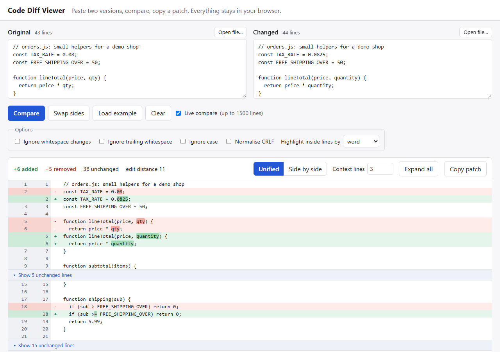

# code-diff-viewer

A text and code diff viewer that runs entirely in the browser: paste two versions, compare, and read the result as a unified or side-by-side diff, or copy it as a standard unified patch. It has no dependencies and no build step. The line diff is my own implementation of Myers' O(ND) algorithm. It is a learning and showcase project, not a replacement for `git diff` or a code review tool.



## What it does

- Two text boxes, a Compare button, and live compare (debounced) for inputs up to 1500 lines.
- Unified and side-by-side views, line numbers for both sides, added, removed and changed colouring.
- Word-level highlighting inside changed lines (or character-level, selectable).
- Unchanged regions collapse, with a configurable number of context lines; each region can be opened and closed, and there is an Expand all button.
- Stats: lines added, removed and unchanged, and the edit distance (line insertions plus deletions).
- Options: ignore whitespace changes, ignore trailing whitespace, ignore case, normalise CRLF. The comparison uses the normalised lines, but the page and the patch always show your original text.
- "Open file..." for either side. A text box always turns CRLF into LF, so this is the way to get a CRLF file into the page unchanged, and it is what makes the Normalise CRLF option meaningful (files up to 5 MB).
- Copy as a unified patch (`--- a/file`, `+++ b/file`, `@@ -l,c +l,c @@`) with correct `\ No newline at end of file` lines. Swap sides, load an example, clear.
- Large inputs: above 5000 lines on either side the page asks for confirmation, then runs the diff in a Web Worker that is stopped after 20 seconds, so the page stays responsive.

## Run it

Needs Node 20 or newer, only to serve static files and to run the tests.

```
npm start            # http://127.0.0.1:8080/   (PORT=3000 npm start to change the port)
npm test             # 102 tests
```

Open it over http, not by double-clicking `index.html`: browsers do not start Web Workers from `file://` pages, and the large-input path then shows an error saying so (small inputs still work). `npm start` serves only `index.html` and `src/`.

## How it is built

```
index.html, src/styles.css   page and styling
src/diff.js                  the whole diff core (UMD, no DOM): Myers, word diff, rows, hunks, patch writer
src/app.js                   DOM only: reads the inputs, builds the views with createElement, Worker with timeout
src/worker.js                Web Worker wrapper around diff.js for large inputs
src/examples.js              the example texts (synthetic)
scripts/serve.js             the static server behind `npm start`
test/                        node:test suites
```

`diff.js` is loaded as a plain script by the page and the worker, and with `require()` by the Node tests, the same pattern as my other small showcase apps.

How the diff works:

1. Each line gets a comparison key (the normalised line, plus a marker when it is a last line without a newline). Keys are turned into integers.
2. A common prefix and suffix are matched first. Myers' algorithm runs on what is left: for d = 0, 1, 2, ... it extends the furthest-reaching path on each diagonal k, following equal lines for free, until a path reaches the end. The work is O((N + M) * D), where D is the number of inserted plus deleted lines, so similar files are fast. The path is recovered by walking back through a saved copy of the search state of each round, which costs O(D^2) memory.
3. Tie-breaking, so that output is deterministic: a deletion is preferred over an insertion on equal reach, diagonals are followed as far as they go, and inside a block of changes all deletions come before all insertions.
4. Rows (`equal`, `delete`, `insert`, with both line numbers) are the shared data model. The unified view, the side-by-side view (the i-th deletion of a block next to the i-th insertion), the collapsing of unchanged runs and the hunks of the patch are all computed from the same rows and the same context rule: an unchanged run is hidden only when it is longer than twice the context, which is also when git starts a new hunk.
5. Paired deleted and inserted lines get a second, token-level Myers diff (words, whitespace runs and punctuation; or single characters). Lines that share less than a quarter of their characters are shown as wholly changed instead of confetti.

## How it is tested

`npm test` runs every file in `test/` with `node --test`: 102 tests, all passing on Node 24 on Windows. (`test/helpers.js` is picked up by the runner too and contains no tests.) The oracles are written independently of the diff code:

- **Myers against brute force** (`myers.test.js`): a dynamic-programming LCS in the test file. On 600 seeded random small sequences per property the edit script rebuilds B from A, the number of insertions plus deletions equals N + M - 2 * LCS (so it is minimal), the number of equal pairs equals the LCS length, and no element is both deleted and inserted inside one block of changes. All 63 x 63 binary sequences up to length 5 are checked exhaustively. The tie-breaking is pinned with exact expected scripts.
- **Patches against an independent applier** (`patch.test.js`): a small unified-patch applier lives in `test/helpers.js`. For seeded random texts, with and without a trailing newline on each side, empty files, a file that is only a blank line, CRLF input, and context 0 to 5, applying the generated patch to A gives B byte for byte. The applier checks every context and removed line, the hunk counts and every `No newline` marker, and the tests show that it rejects wrong patches. Identical files give an empty patch.
- **Hunk arithmetic** (`hunks.test.js`): exact headers for changes at the start, middle and end, pure insertions and deletions, the `0,0` convention for empty sides and for context 0, offsets after earlier hunks, the merge rule (gap of exactly 2 x context merges, one more splits), and a randomised check that start and count agree with a plain count of the rows.
- **Word diff** (`worddiff.test.js`): as a seeded property, each side's parts joined give back that side's line exactly, and the unchanged text is the same on both sides.
- **Options** (`options.test.js`): ignored differences keep the original text on each side, a patch made with options on applies to A and gives B up to the ignored differences.
- **Performance and the size guard** (`perf.test.js`): 2000-line files with 100 random edits diff in about 20 ms; a completely different 3000 x 3000 input and a 2500-line reversed file hit the size guard (flagged approximate) in about 0.1 s and still produce a patch that applies. These tests assert generous time limits, so they catch a wrong complexity, not a small slowdown.
- **Comparison with git** (`git-compare.test.js`, skipped if git is not installed): see the next section.
- **Server and page wiring** (`serve.test.js`, `examples.test.js`): path traversal attempts against the static server, element ids used by `app.js` exist in `index.html`, and no HTML-string sinks (`innerHTML` and similar) in `src/`.

### Against `git diff --no-index`

Compared from the first `@@` on, with git's function-context text after the header removed (git writes `@@ -16,6 +16,7 @@ row 14`; this tool writes only the header). The file header lines differ by design: git adds `diff --git` and `index` lines and uses the real paths, this tool writes `--- a/file` and `+++ b/file`. Both omit `,1` in a range of one line. Checked with git 2.53.0 on Windows:

- 14 fixed inputs (one change, added or removed first and last lines, two distant changes, empty to text and back, identical, final newline added and removed, CRLF, blank lines) at context 0, 1 and 3: identical hunks.
- 200 seeded realistic edits (a few inserted, deleted or changed lines in one file): identical (100 of them run in `npm test`).
- 200 seeded random pairs of unrelated texts with a tiny vocabulary of repeated lines (a harder case with many equally good alignments): 177 identical, 23 different. In the 23 the two patches contain the same number of added and removed lines, so both are minimal; they choose a different one among equally short scripts. This tool does not claim to reproduce git's choice when several are possible.

Not compared: file modes, new-file and deleted-file headers (git prints `new file mode`, this tool just uses `-0,0`), binary files, renames, and `--patience` or `--histogram` output.

### The browser check is manual

The page itself has no automated test in the repository. I drove the real page in headless Chrome (`--virtual-time-budget`, `--dump-dom`) with a throwaway script that is not part of this repo: it was appended to a copy of the app in a scratch directory outside the repository and served from there. It passed 41 checks on its last run:

- Compare renders the unified view with line numbers for both sides, added and removed colouring, and stats; the side-by-side view puts a removed cell next to an added one.
- Word highlighting appears inside changed lines in both views (for example only `0825` is highlighted in `const TAX_RATE = 0.0825;`).
- Unchanged regions are collapsed; a fold opens and closes, Expand all works, context 0 shows only changed rows and a huge context shows no folds.
- Ignore whitespace, ignore case and Normalise CRLF each turn a changed pair into "no differences", and with ignore whitespace the original text (`  b   c`) is still what is displayed.
- The copied patch text equals the expected string exactly, including a `\ No newline at end of file` line; swap recompares; live compare updates after the debounce.
- A 5001 against 5002 line input shows the large-input warning; Compare anyway runs the diff in the Web Worker and renders the result with three collapsed regions.
- Clicking Copy patch in headless Chrome: the clipboard write was refused (or left pending), so the page showed its fallback, the patch in a text box with a notice. A successful clipboard write in a normal browser window was not checked.

The check found real problems, now fixed: (1) a `<textarea>` turns CRLF into LF by itself, so the CRLF option could never have had an effect on pasted text; the page now has "Open file..." buttons that keep the file's CRLFs and say "CRLF" next to the line count; (2) when the browser leaves the clipboard promise pending, the Copy button did nothing and showed nothing; it now gives up after 1.5 seconds and shows the fallback. A screenshot (`docs/screenshot.png`) was taken with headless Chrome at 1280 x 900 and looked at.

Caveat about the check itself: under virtual time the page's own 20 second worker timer fires as soon as the page idles, before a real Worker can answer. In the throwaway script the polling loop therefore burns a few real milliseconds per poll. The script and the harness are not in the repo, so this is described, not reproducible from here.

## Limits

- Lines only, as plain text. No syntax highlighting, no moved-block detection, no merging or patch application in the page.
- Myers' worst case is a big difference. The cost is O((N + M) * D) time and O(D^2) memory for the saved search state, so two long files that share almost nothing are the slow case. The size guard stops the exact search after 3000 inserted plus deleted lines and falls back to replacing the unmatched middle wholesale. That result is valid (a test applies its patch) but not minimal, and the page says so. A reversed file is another bad case, since it is mostly deletions and insertions. Real tools add heuristics (git skips lines that occur on only one side, and has `--patience` and `--histogram`); this one does not.
- Line endings: lines split on `\n` only, a lone `\r` is not a line break. Text typed or pasted into a box always has LF endings (the browser's doing); only files opened with "Open file..." can carry CRLF. With CRLF against LF every line differs unless Normalise CRLF is on; the page says so when it sees different endings. Files are decoded as UTF-8.
- A missing final newline counts as a difference, as in git, unless an ignore-whitespace option is on.
- "Ignore whitespace changes" collapses runs of whitespace and trims each line (like `git diff -b`), so `a b` still differs from `ab`.
- With ignore options on, the copied patch describes only the differences that were not ignored: lines treated as equal are written as context from the original, so the patch would not turn the original into the changed text byte for byte.
- "Edit distance" is the number of inserted plus deleted lines. It is not Levenshtein distance, where a changed line would count once.
- Word-level highlighting pairs the i-th deleted line with the i-th inserted line of a block and skips pairs that are too different, so a block that was re-ordered may show whole lines instead of word changes. Lines over 1500 tokens are not highlighted inside.
- The page renders every row of a diff; a diff with tens of thousands of changed lines will be slow to draw even though the diff itself is fast. Unchanged regions are collapsed, so large files with few changes are fine.
- Verified in Chrome only (headless, once, as described below). Other browsers are untested, though the page uses only standard APIs (`Worker`, `navigator.clipboard` with an `execCommand` fallback). If copying is refused, the patch is shown in a text box instead.
- The 20 second worker timeout is implemented but I did not exercise it in a browser, because no input in my check took that long; the size guard returns first.
- Not deployed anywhere. To publish it, enable GitHub Pages for the repository and serve the repository root.
- CI: the workflow (`.github/workflows/ci.yml`) runs `npm test` on Node 20, 22 and 24. CI ran green on all three Node versions on the first run on GitHub Actions (ubuntu-latest, 2026-10-20).

## Clone

```
git clone https://github.com/Supp3r-Man/code-diff-viewer.git
cd code-diff-viewer
npm start
```

MIT licensed.
